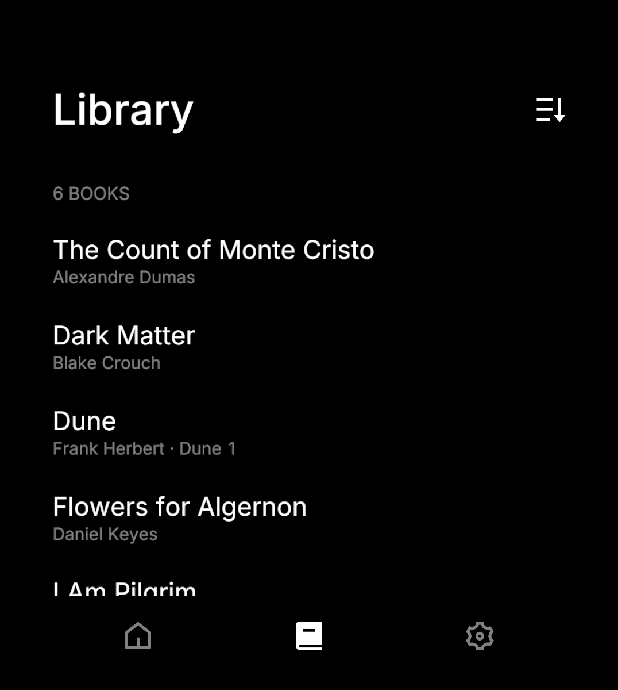

<div align="center">

### maia


**Read EPUB books on your Unihertz Titan 2 Elite.**

</div>

maia is a personal Android e-reader for the Unihertz Titan 2 Elite.

<p align="center">
  
  
  
</p>

## Features

- **EPUB library:** Titles, authors and series from your books.
- **Sort order:** Recently added, Title or Author.
- **Continue reading:** Pick up where you left off, with recent books on Home.
- **Chapters:** Jump straight to a chapter from the book's contents.
- **Reading settings:** Choose fonts, text size, line spacing, margins and hyphenation.
- **Page turns:** Use the physical keys, keyboard touchpad or screen.

## Requirements

- Unihertz Titan 2 Elite
- Android 14 or later
- EPUB books

## Install

Install maia with [Obtainium](https://github.com/ImranR98/Obtainium) to receive updates.

1. Install [Obtainium](https://github.com/ImranR98/Obtainium/releases).
2. In Obtainium, touch **Add App**.
3. Paste this URL as the app source, then touch **Add**:

   ```text
   https://github.com/juleshall4/uniread
   ```

4. Touch **Install**.

## Privacy

Books, reading progress and settings stay on your device. maia has no account or analytics.

## Credits

maia uses these projects:

- [Ink](https://github.com/No-Scrolling/ink): the app framework (MIT)
- [Inter](https://rsms.me/inter/): interface and reading typeface (SIL Open Font Licence)
- [Literata](https://github.com/googlefonts/literata): reading typeface (SIL Open Font Licence)
- [Remix Icon](https://github.com/Remix-Design/RemixIcon): tab and sort icons
