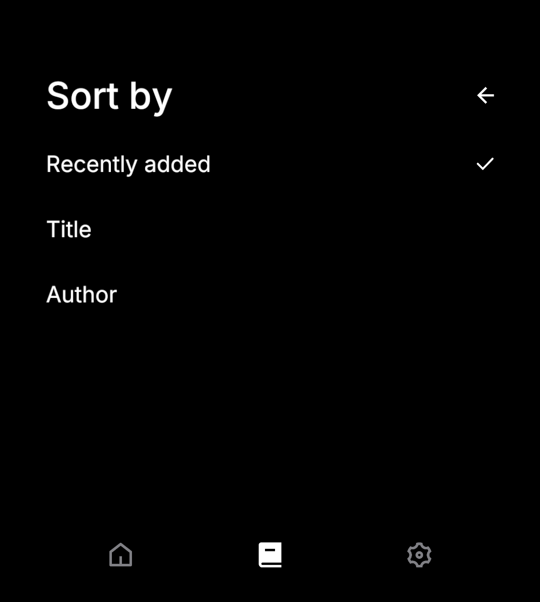
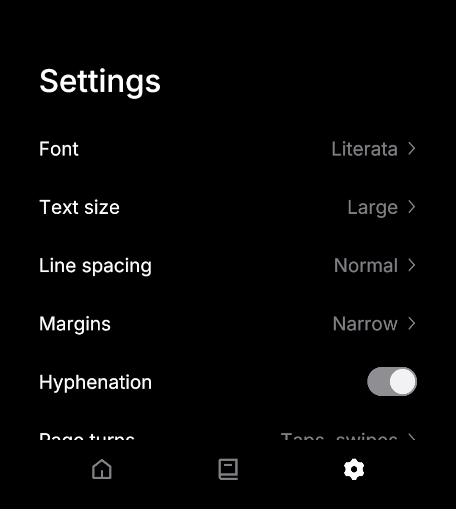
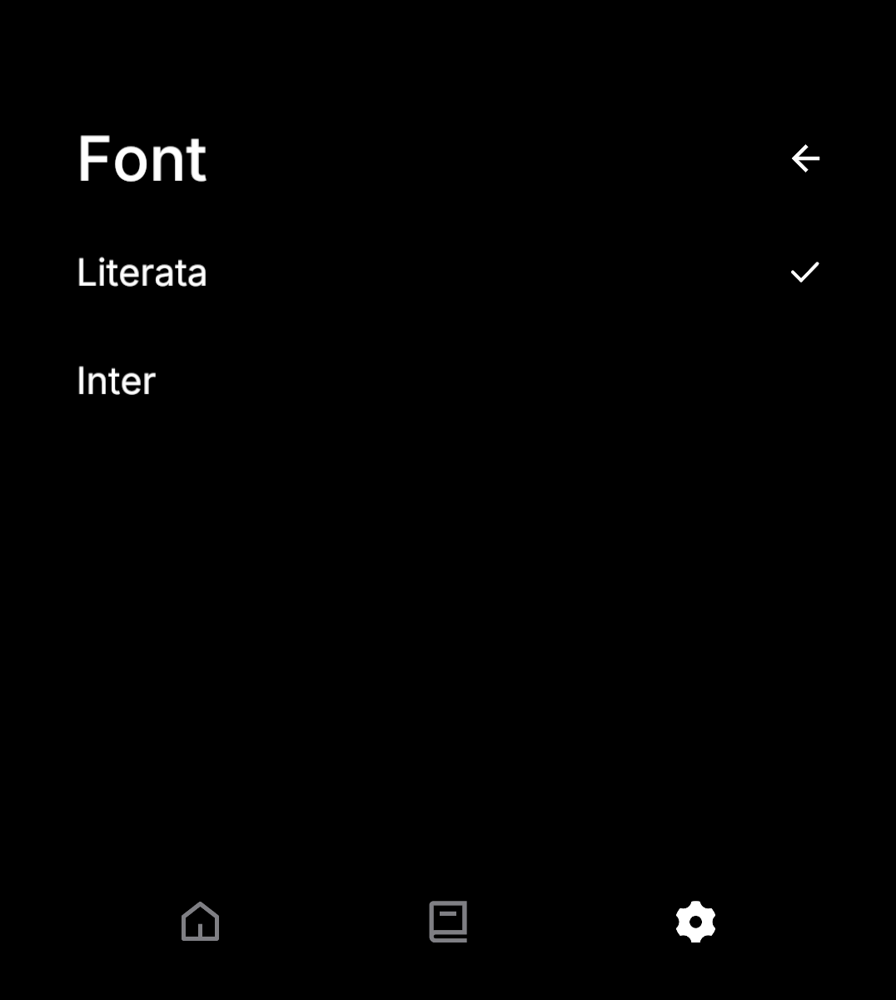

<div align="center">

### maia


**Read EPUB books on your Unihertz Titan 2 Elite.**

</div>

maia is a personal Android e-reader for the Unihertz Titan 2 Elite, built with [Ink](https://github.com/No-Scrolling/ink). It has Home, Library and Settings tabs, with page turns on the physical keys, keyboard touchpad or screen. Books and reading progress stay on your device.

## Features

### Library

<p align="center">
  
  
</p>

Copy EPUBs into the books folder, then open maia. The library reads their titles, authors, series and chapters.

- **Sort order:** Recently added, Title or Author. maia remembers your choice.
- **Continue reading:** Open the last book from Home, at the place you left it.
- **Recent books:** Other books you have opened appear below it.
- **Chapters:** Open a book's contents to go straight to a chapter.

### Reading

<p align="center">
  
  
</p>

Choose the reading settings that suit you. Nested settings have a back arrow at the top right.

- **Fonts:** Literata or Inter, with three text sizes.
- **Layout:** Adjust line spacing and margins.
- **Hyphenation:** Turn word hyphenation on or off. It starts on.
- **Page turns:** Turn keys, taps and sideways swipes on or off independently. Volume keys, arrows and Space go forward; Shift+Space goes back. On the screen, the left third goes back and the rest goes forward.
- **Reading position:** Back closes the reader and saves your place.
- **Bottom-right display:** Show time left in the chapter, chapter number, pages left, chapter or book page counts, book percentage, or nothing.

Page counts follow your current font and layout. Whole-book totals are counted in the background. Chapters follow the table of contents, or each EPUB file when there is no table of contents.

### Keyboard

Turn off **Backlight when reading** in Settings to keep the physical keyboard dark while a book is open. If the light is already on, it goes off after the Titan's keyboard light timeout. With the timeout set to always on, it stays on.

### Calibre

The calibre wireless connection is not built yet. For now, copy EPUBs over adb. Open maia once first, so it creates its books folder:

```sh
adb push book.epub /sdcard/Android/data/dev.maia/files/books/
```

The library matches the folder each time the app starts. Edit metadata in calibre before copying a book.

## Requirements

- Unihertz Titan 2 Elite
- Android 14 or later
- EPUB books

## Install

Build a development APK using the local Ink checkout described below, then install it:

```sh
adb install -r dist/maia-0.1.0-debug.apk
```

This updates the existing development app and keeps its books, settings and reading progress.

## Privacy

Books, reading progress and settings stay on your device. maia has no account or analytics.

## Development

Keep the local [Ink](https://github.com/No-Scrolling/ink) checkout beside maia at `../ink`. Development needs Bun, Rust, Java 21, Kotlin and the Android SDK.

On macOS with Homebrew:

```sh
export JAVA_HOME="$(brew --prefix openjdk@21)/libexec/openjdk.jdk/Contents/Home"
export ANDROID_HOME="$HOME/Library/Android/sdk"
export KOTLIN_HOME="$(brew --prefix kotlin)/libexec"
```

Install dependencies, run the checks and build:

```sh
bun install
../ink/scripts/ink check
bun test
bash test/pagination.sh
../ink/scripts/ink build --debug
```

Test reading and keyboard controls on a real Titan 2 Elite. An emulator does not have its physical keyboard.

Designs are in the Paper file [Titan e-reader](https://app.paper.design/file/01M7DXY8CCYZYSH7FP63Z2QJQ3).

## Credits

maia uses these projects:

- [Ink](https://github.com/No-Scrolling/ink): the app framework (MIT)
- [Inter](https://rsms.me/inter/): interface and reading typeface (SIL Open Font Licence)
- [Literata](https://github.com/googlefonts/literata): reading typeface (SIL Open Font Licence)
- [Remix Icon](https://github.com/Remix-Design/RemixIcon): tab and sort icons
